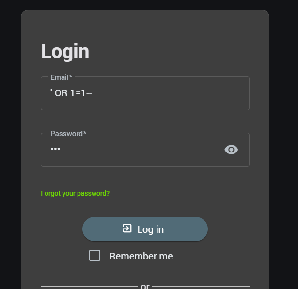
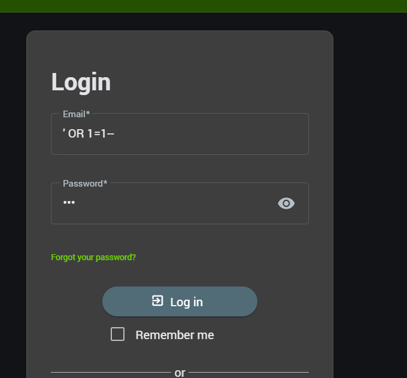
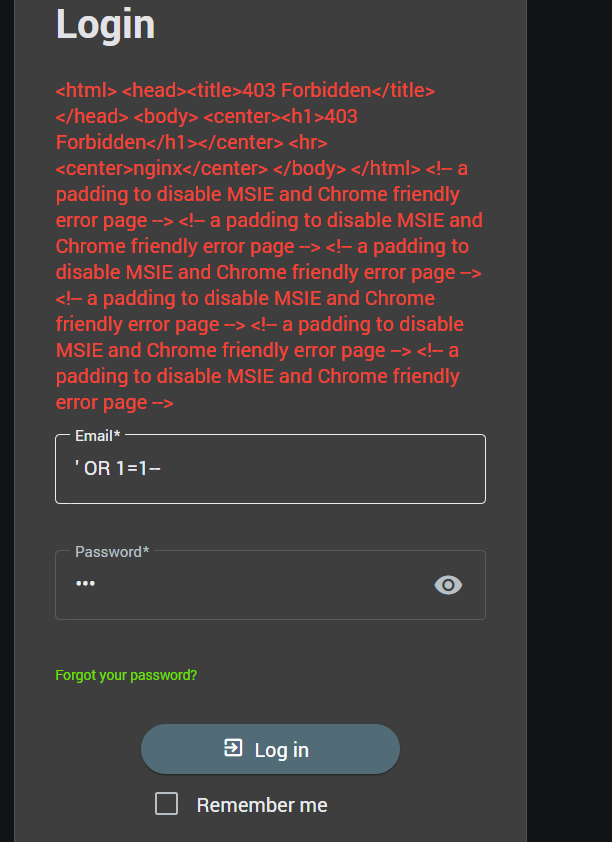
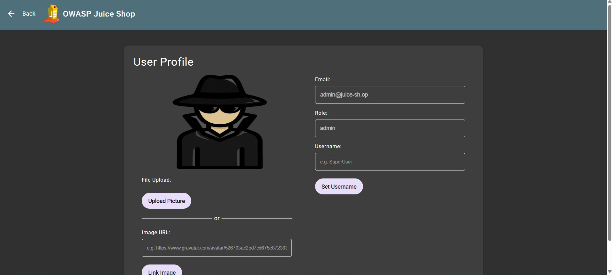
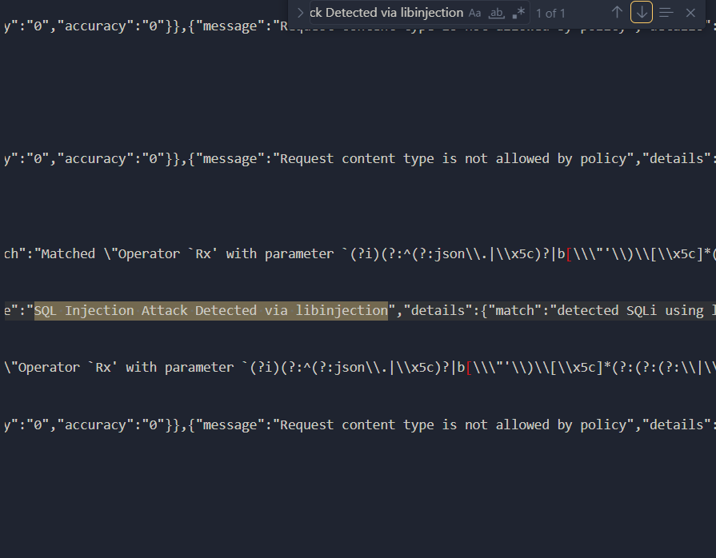

## Demo
Bài 1: Tấn công ko qua WAF

Tên đăng nhập ' OR 1=1-- (SQL Injection)

Vào đc thành công
Bài 2: Tấn công qua WAF

Gõ đúng payload trên, nhưng WAF không cho vào.
Bài 3: Đăng nhập đúng

Gõ đúng tk/mk, vào thành công
Bài 4: Test log

Khi truy cập log, nó hiện ra "SQL Injection Attack Detected via libinjection".